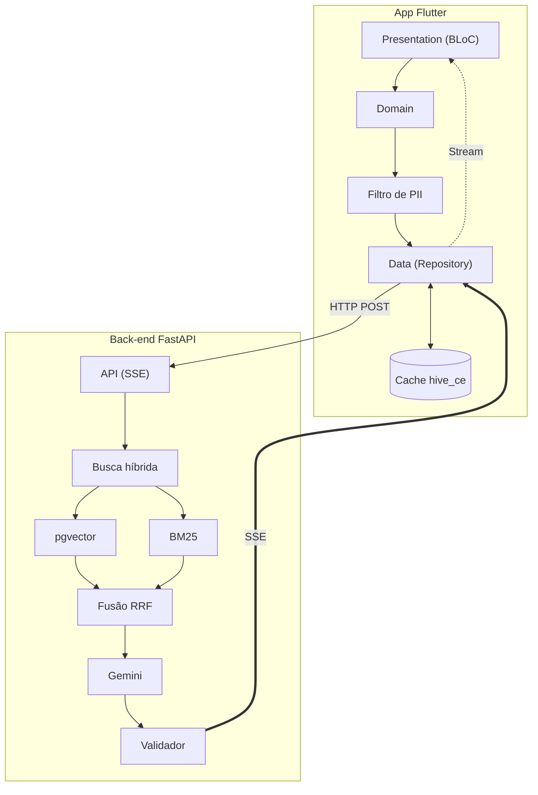

# Evidências OE2 e OE3

Gerado em 2026-11-23. Nenhum código do app foi alterado. Origem: `app/` (Flutter), `flutter test --coverage`, `app/coverage/lcov.info`.

## 1. Testes e cobertura por camada

`flutter test --coverage`: **325 testes, 325 aprovados, 0 falhas, 0 ignorados** ("All tests passed!").

| Camada | Linhas cobertas / executáveis | Cobertura |
|---|---|---|
| domain | 292 / 310 | **94,2 %** |
| data | 282 / 284 | **99,3 %** |
| presentation | 1576 / 1634 | **96,5 %** |
| *core (apoio)* | 136 / 163 | 83,4 % |
| *shared (apoio)* | 128 / 130 | 98,5 % |
| *onboarding_module.dart* | 8 / 8 | 100 % |

Método: soma de `LH`/`LF` do `lcov.info`, agrupando cada arquivo pelo diretório (`domain/`, `data/`, `presentation/`) dentro de `lib/features/*`. `core/`, `shared/` e `onboarding_module.dart` não pertencem a nenhuma das três camadas e ficam em linhas à parte. Os percentuais por camada são de linhas, não de ramos.

Limitação: o `lcov.info` do Flutter só lista arquivos que algum teste importa. Dos 106 arquivos de `lib/`, 91 estão no relatório. Os 15 ausentes não entram nos percentuais acima:

- `main.dart`, `core/di/injection.dart`, `core/di/injection.config.dart`, `core/theme/tokens.dart`, `sobre/presentation/versao_app.dart` e `telemetria/data/services/servicos_telemetria.dart`;
- 8 interfaces e contratos de `domain/` (`*_repository.dart` e `consulta/domain/sanitizador.dart`), que não têm linha executável.

Os 7 arquivos com código real (`servicos_telemetria.dart` na camada data, `versao_app.dart` na presentation e os de `core/`) não entram na conta. Se forem incluídos, data e presentation caem um pouco.

## 2. Regra de dependência (domain não importa data, presentation nem UI)

Verificação: script Python sobre todos os `import`/`export` dos **42 arquivos** em `domain/` (`lib/features/*/domain/`).

Imports encontrados:

| Destino | Qtd |
|---|---|
| `package:app/...` em outro `domain/` | 53 |
| `package:app/core/...` (só `core/error/failures.dart`, que importa apenas `equatable`) | 24 |
| `package:fpdart` | 24 |
| `package:equatable` | 8 |
| `dart:convert` | 1 |
| `package:crypto` | 1 |

Imports de `data/`, `presentation/`, `package:flutter*`, `flutter_bloc`, `hive_ce*`, `dio`, `get_it`, `injectable` ou `dart:ui`: **0**.

**Resultado: nenhuma violação.** O domain depende só de Dart puro, `fpdart`, `equatable` e `crypto`. As menções a `hive_ce` em `domain/` são comentários (`resposta_salva.dart:11`, `resposta_cache_repository.dart:5`), não imports.

Ressalva: `domain/` importa `core/error/failures.dart` (24 vezes). A regra pedida não proíbe `core/`, e o arquivo é Dart puro, mas vale mencionar no texto do TCC.

## 3. Diagrama da arquitetura

Fonte Mermaid: [`img/arquitetura.mmd`](img/arquitetura.mmd) (vertical, caixas curtas). Se ainda ficar grande na página, use as duas figuras separadas: [`img/arquitetura_app.mmd`](img/arquitetura_app.mmd) (app em Clean Architecture) e [`img/arquitetura_backend.mmd`](img/arquitetura_backend.mmd) (pipeline do back-end).

**PNG: não gerado.** A exportação precisa do `@mermaid-js/mermaid-cli`, que baixa um Chromium via `npx`. O ambiente bloqueou essa instalação e eu não a contornei. Para gerar:

```
npx -y @mermaid-js/mermaid-cli -i docs/img/arquitetura.mmd -o docs/img/arquitetura.png -s 3 -b white
```

Ou cole o código abaixo em https://mermaid.live e exporte o PNG.



**Legenda (detalhes que saíram das caixas):**
- *Presentation (BLoC):* páginas e Cubits/BLoCs; dependem só de casos de uso do domain.
- *Domain:* entidades, casos de uso e interfaces de Repository, em Dart puro. `MontarCorpoConsulta` está aqui.
- *Filtro de PII:* interface `Sanitizador` no domain; implementação com regex em `core/privacy/`. Roda no app, antes do envio.
- *Data (Repository):* `RepositoryImpl` e fonte remota com Dio (SSE). Implementa as interfaces do domain.
- *Cache hive_ce:* respostas guardadas, configuração e telemetria no aparelho.
- *API (SSE):* FastAPI, `POST /consulta`, autenticação por `X-API-Key`, resposta por Server-Sent Events.
- *Busca híbrida:* pgvector (busca semântica, índice HNSW) e BM25 (lexical, `bm25s`) em paralelo.
- *Fusão RRF:* Reciprocal Rank Fusion com k=60.
- *Gemini:* geração com citação obrigatória, só sobre os trechos recuperados.
- *Validador:* checa citações e trechos; só o que passa segue. Os eventos validados voltam ao app pela conexão SSE aberta pela API.

**Onde o diagrama difere do fluxo descrito no pedido:** o filtro de dados pessoais roda **no app, antes de a consulta sair para a API**, e não depois dela. Em `corpo_consulta.dart:85`, `MontarCorpoConsulta` chama `_sanitizador.sanitizar(...)`, e o backend recebe a pergunta já sanitizada (`backend/app/api/consulta.py:37`). O diagrama segue o código. O `docs/ARCHITECTURE.md` descrevia a sanitização dentro de `RealizarConsulta` (versão original, linhas 76–86), mas o código real a faz em `MontarCorpoConsulta`. *Atualizado em 23/11/2026:* o `ARCHITECTURE.md` já foi corrigido (commit `f053891`) e descreve o fluxo atual, com a seção «Onde fica o filtro de dados pessoais»; a divergência não existe mais.
